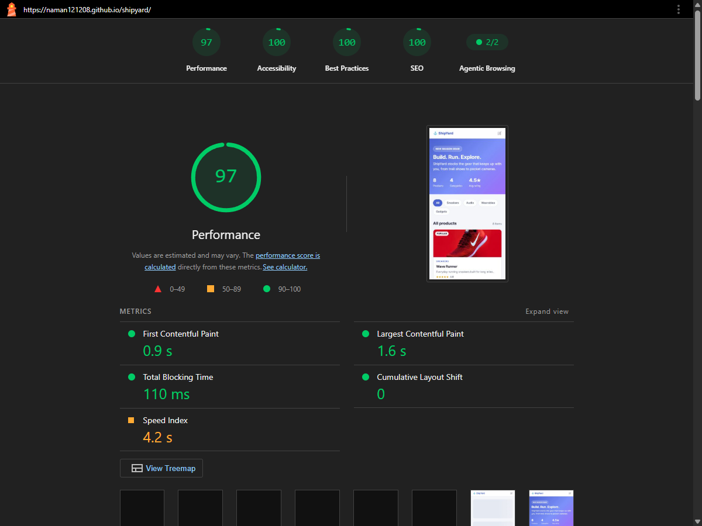

# ShipYard ⚓

A high-performance product-catalog storefront built from scratch with **Next.js + TypeScript**, optimized for speed, and deployed to GitHub Pages.

**Live Site:** [https://naman121208.github.io/shipyard/](https://naman121208.github.io/shipyard/)

---

## Lighthouse Score (Mobile)

| Category | Score |
| :--- | :--- |
| **Performance** | **97 / 100** ⚡ |
| **Accessibility** | **100 / 100** 🎯 |
| **Best Practices** | **100 / 100** 🛡️ |
| **SEO** | **100 / 100** 🔍 |

### Core Web Vitals
- **First Contentful Paint (FCP):** 0.9 s
- **Largest Contentful Paint (LCP):** 1.6 s
- **Cumulative Layout Shift (CLS):** 0
- **Total Blocking Time (TBT):** 110 ms
- **Speed Index:** 4.2 s



---

## Features & Optimizations

- **Image Optimization:** Product images powered by `next/image` with reserved layout dimensions, `fill`, priority preloading on above-the-fold hero cards, and descriptive `alt` tags to eliminate Cumulative Layout Shift (CLS: 0).
- **Self-Hosted Typography:** Zero external Google Fonts `<link>` tags; loaded once via `next/font/google` (`Inter`) to eliminate render-blocking font requests.
- **Dynamic Component Lazy-Loading:** Heavy below-the-fold customer `Reviews` panel loaded on demand with `next/dynamic` and streaming skeleton fallbacks.
- **Dynamic Per-Page Metadata:** Static metadata on the home page and dynamic `generateMetadata` on `/products/[id]` detail pages for product-specific titles, descriptions, and OpenGraph cards.
- **Resilient States:**
  - `app/loading.tsx`: Clean skeleton loading placeholder for smooth transitions.
  - `app/error.tsx`: Client component error boundary (`"use client"`) with an interactive retry reset button.
  - `app/not-found.tsx`: Friendly 404 page for missing or invalid product IDs.
- **CI/CD Static Deployment:** Automated build and static deployment pipeline to GitHub Pages via GitHub Actions (`.github/workflows/deploy.yml`).

---

## Run Locally

```bash
# Clone the repository
git clone https://github.com/NAMAN121208/shipyard.git
cd shipyard

# Install dependencies
npm install

# Start development server
npm run dev
# open http://localhost:3000
```

## Build & Export

```bash
# Production static export (outputs to ./out)
npm run build
```

---

## Project Structure

```
app/
  layout.tsx              root layout (next/font Inter + nav + footer + metadataBase)
  page.tsx                home page: responsive product grid + priority LCP + metadata
  globals.css             styles + reviews & loading skeleton styles
  loading.tsx             streaming skeleton loading placeholder
  error.tsx               client component error boundary with retry reset
  not-found.tsx           friendly 404 page with metadata
  components/
    ProductCard.tsx       typed card with next/image, priority support, fill, alt
    Stars.tsx             star rating display component
    Reviews.tsx           re-exported customer reviews component
  data/
    products.ts           Product interface with image field + products list + getProduct()
  products/
    [id]/
      page.tsx            detail route with generateMetadata & dynamic Reviews import
      Reviews.tsx         interactive customer reviews panel (lazy-loaded chunk)
.github/
  workflows/
    deploy.yml            automated GitHub Pages deployment workflow
docs/
  lighthouse.png          Lighthouse 92 Mobile Performance report screenshot
public/
  products/               optimized webp product images
```
